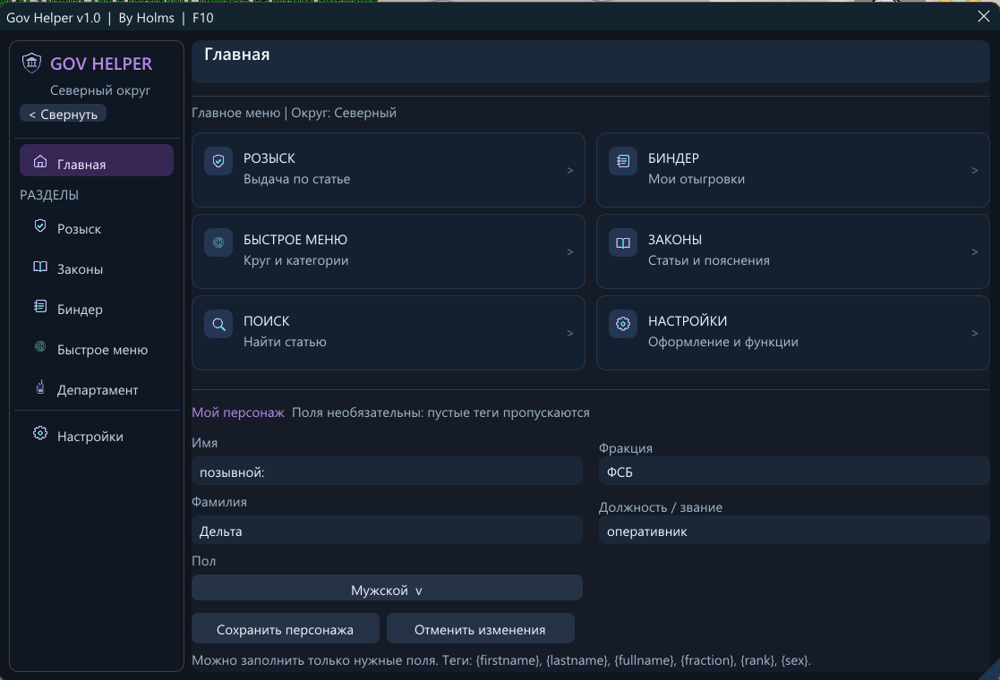
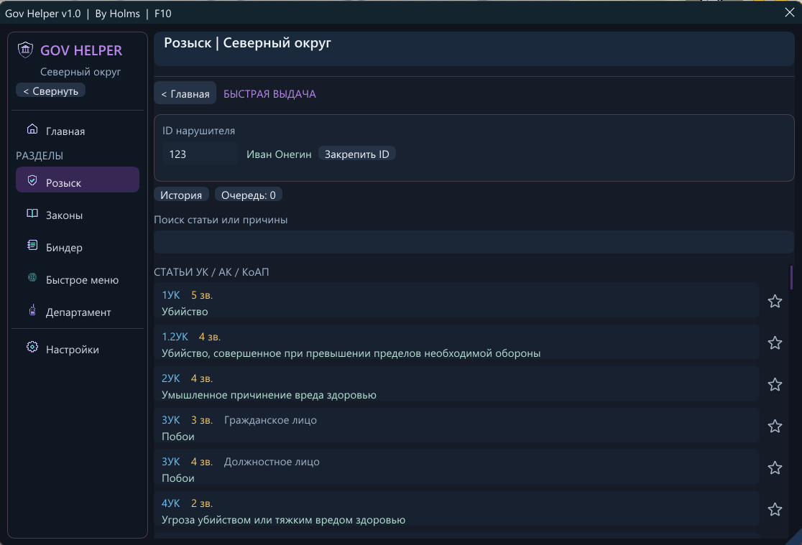
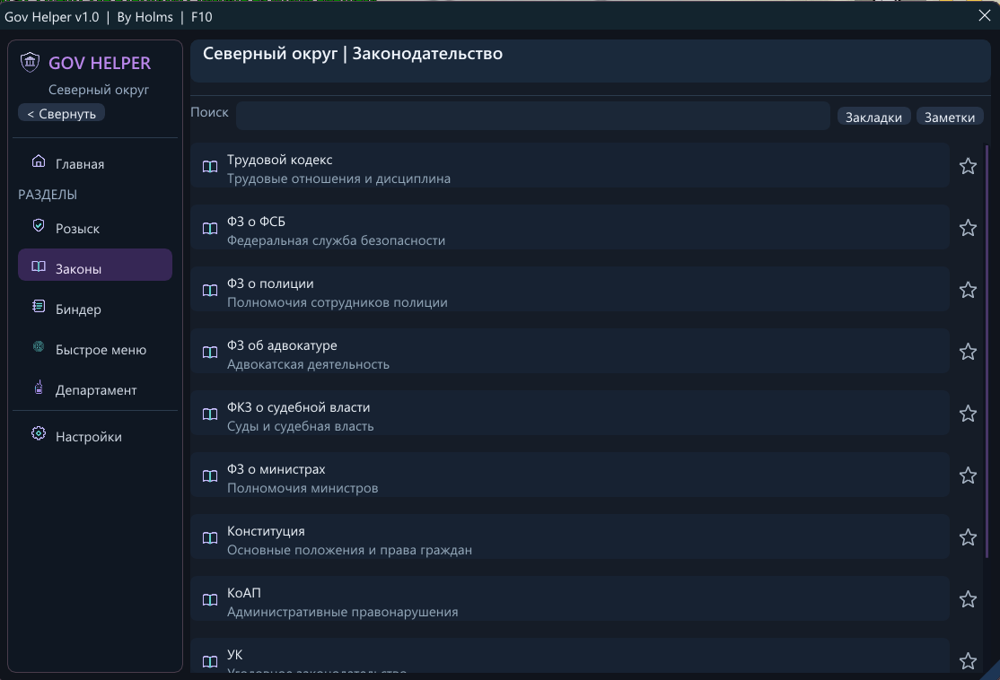
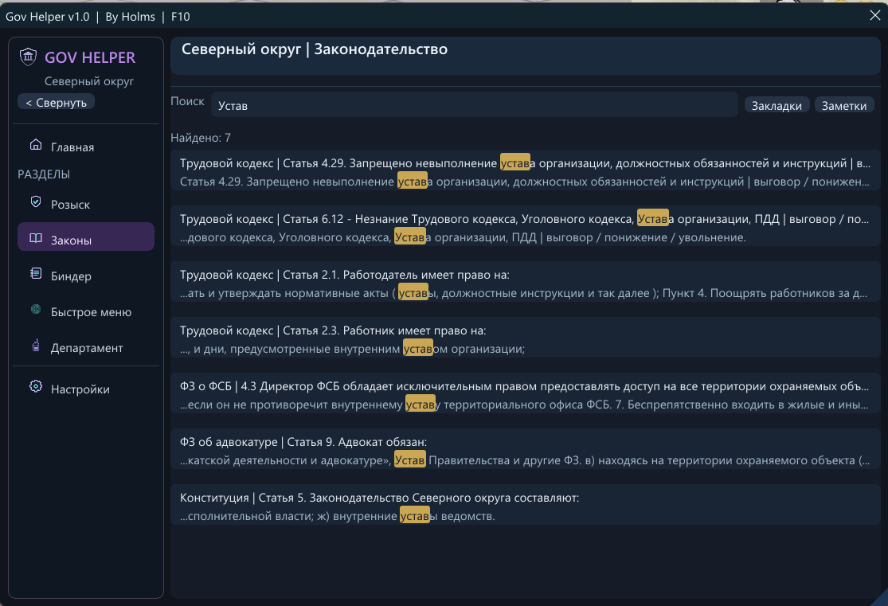
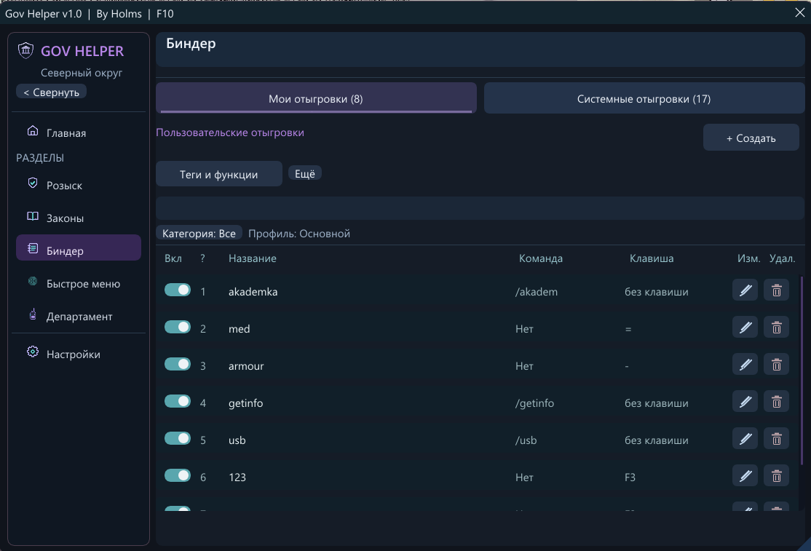
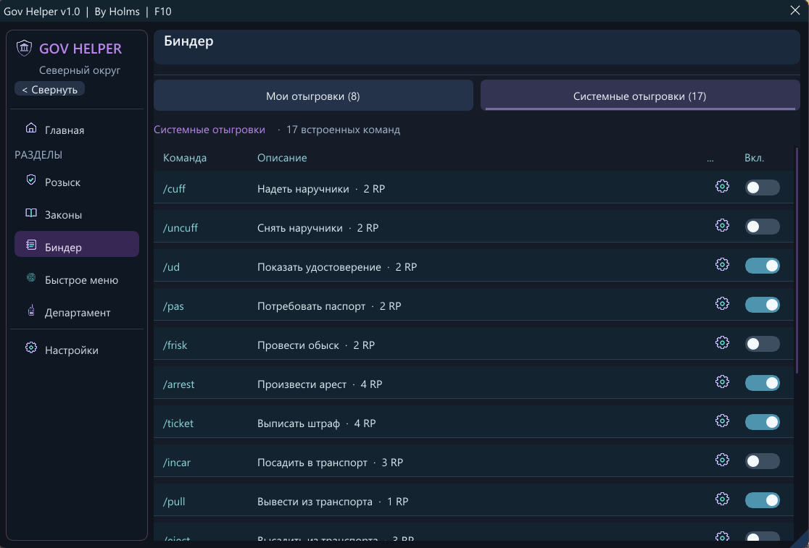
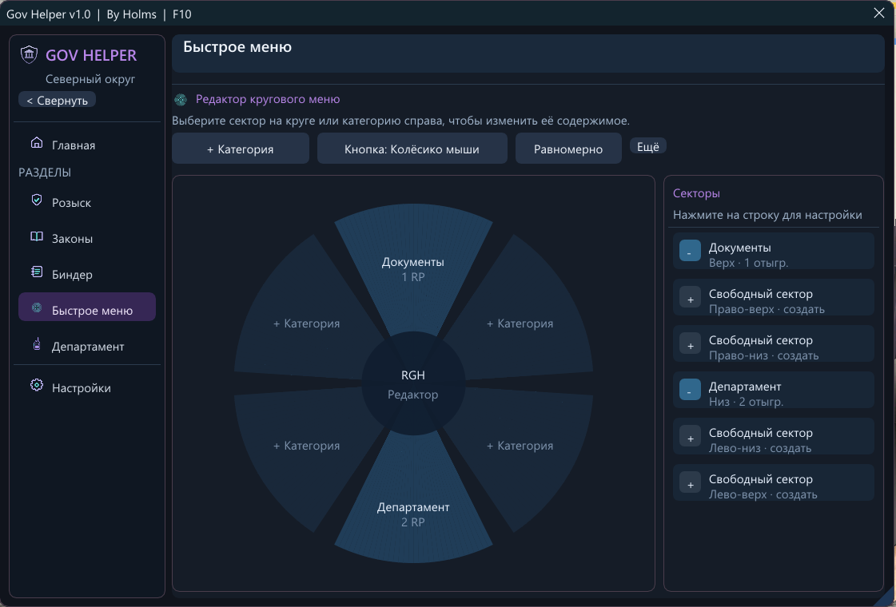
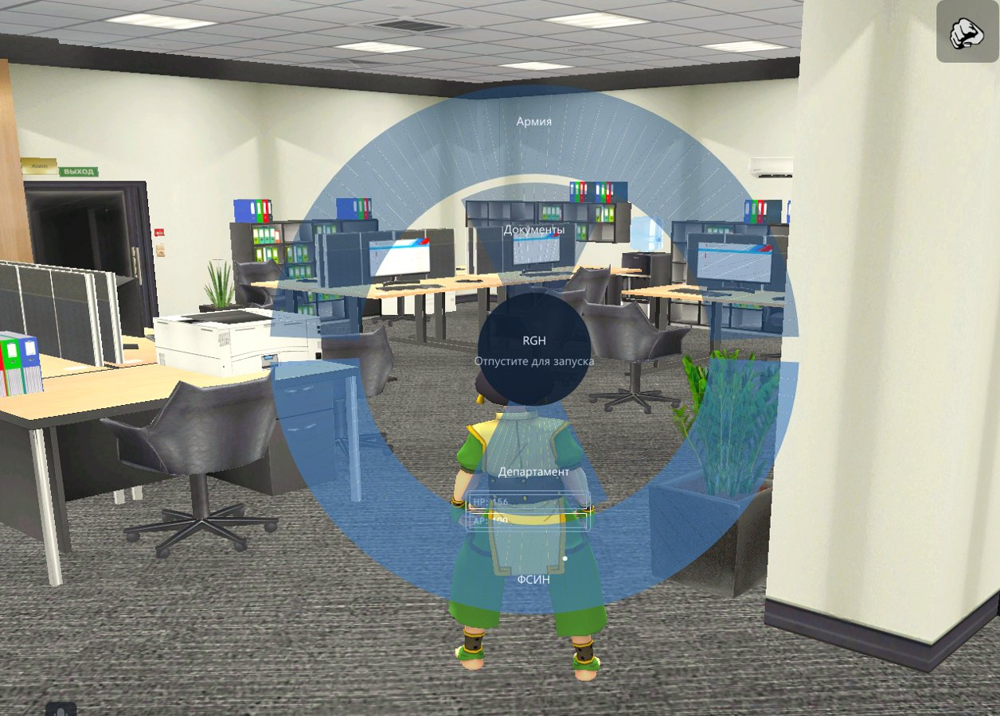
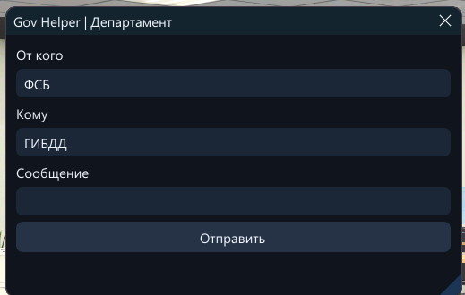
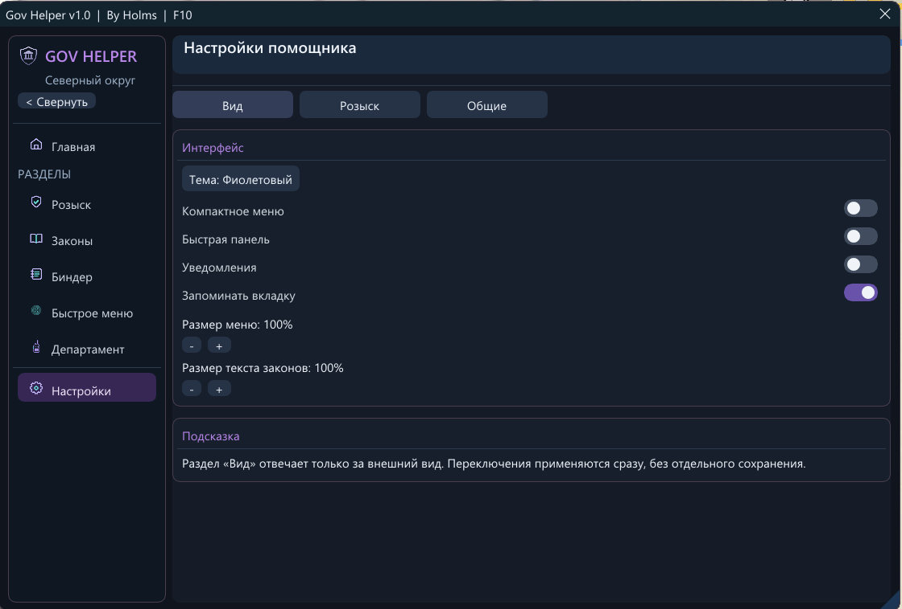

  

  # Gov Helper v1.0 — By Holms

  Помощник государственных организаций для **Rodina RP** на **MoonLoader**.

  [Скачать v1.0](https://github.com/Melllok/GovHelper/releases/tag/v1.0) · [Сообщить о проблеме](https://github.com/Melllok/GovHelper/issues)

## Возможности

- **Розыск:** удобный поиск статей УК, АК и КоАП и выдача розыска из интерфейса.
- **Законодательство:** локальные базы семи округов, поиск по статьям, закладки и заметки.
- **Округа:** определение по серверу и резервное ручное переключение через `/govdistrict`.
- **Биндер:** личные и системные отыгровки, горячие клавиши, условия и задержки.
- **Быстрое меню:** настраиваемые сектора и запуск действий колесом мыши.
- **Департамент:** составление сообщения с произвольными тегами «От кого» и «Кому».
- **Настройки:** темы оформления, масштаб, команда и клавиша открытия.

## Скриншоты

Нажмите на изображение, чтобы открыть его в полном размере.

| Главное меню | Розыск |
|:---:|:---:|
|  |  |

| Законодательство | Поиск по законам |
|:---:|:---:|
|  |  |

| Личные отыгровки | Системные отыгровки |
|:---:|:---:|
|  |  |

| Редактор кругового меню | Быстрое меню в игре |
|:---:|:---:|
|  |  |

| Департамент | Настройки |
|:---:|:---:|
|  |  |

## Установка

В [**Releases**](https://github.com/Melllok/GovHelper/releases/tag/v1.0) доступны два варианта:

1. **GovHelper-v1.0-Setup.exe** — запустите мастер установки и укажите папку игры.
2. **GovHelper-v1.0-Manual.zip** — для ручной установки распакуйте файлы в папку `moonloader`.

**Перед установкой закройте игру.** При обновлении сохраните резервную копию настроек и личных биндов. Для работы требуются MoonLoader и совместимые зависимости.

Обычно главное меню открывается клавишей **F10** или командой **`/govmenu`**, но их можно переназначить в настройках.

## Безопасность и поддержка

- Распространяется защищённая сборка (`.luac` и `RGHCore.dll`); исходный Lua/C++-код в публичном репозитории отсутствует.
- Проверить целостность установщика и ручного архива можно по `SHA256SUMS.txt` в [релизе](https://github.com/Melllok/GovHelper/releases/tag/v1.0).
- Установщик не имеет цифровой подписи: Windows может показать предупреждение о неизвестном издателе. Для желающих доступна ручная установка через ZIP.
- Встроенные локальные базы законов отражают состояние на момент подготовки пакета; перед применением статей сверяйтесь с актуальными правилами своего округа.

**Автор: Holms.**